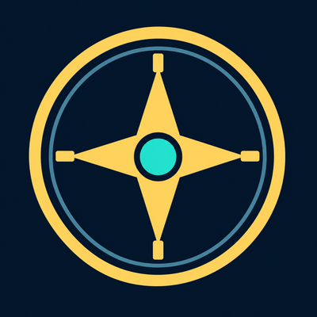

# AzerothBuddy 1.0.7

Eine gemeinsame Zentrale für Charaktere, Tiefenbegleiter, Omnium-Runen, Dungeon-Transmog, Schaden und Heilung sowie Aktionsleisten-Vorlagen.

**Client:** WoW Retail / Midnight · **Interface:** 120105 · **Eigenständig:** keine zusätzlichen Addons erforderlich.

## Funktionen

- Charakterübersicht und eigener verschiebbarer Minimap-Kompass.
- Valeera-Beratung mit Rollen-, Gift- und Kuriositätenauswahl.
- Omnium-Vorlagen für Tank, Heiler und Schaden.
- Dungeon-Transmog, Schadens-/Heilungsanzeige und Leistenvorlagen je Klasse und Spezialisierung.

## Sprachen und aktueller Stand

Die Spielsprache bestimmt die Texte: Deutsch (`deDE`), Englisch (`enUS`, `enGB`), sonst Englisch. Die gemeinsame Codebasis lädt `Locales/enUS.lua` und anschließend die deutschen Übersetzungen. Namen aus Blizzard-APIs (z. B. Gegenstände, Zauber und Klassen) folgen weiterhin der Clientsprache.

- Die Zentrale schließt beim Aufrufen eines Moduls; Aktionsleisten behalten das Menü offen.
- Englische Aliasse `relaxed`, `safe` und `fast` für die Valeera-Befehle.

## Installation

Das Installations-ZIP unter [Releases](https://github.com/norushflow/AzerothBuddy/releases) herunterladen und den enthaltenen Ordner `AzerothBuddy` in `Interface/AddOns/` des passenden Spielclients entpacken. Die Datei `AzerothBuddy.toc` muss direkt in diesem Ordner liegen. Anschließend im Spiel aktivieren und `/reload` ausführen.

Für WowUp die [Repository-Adresse](https://github.com/norushflow/AzerothBuddy) importieren und den passenden Spielclient wählen.

## Bedienung

- `/ab` oder `/azerothbuddy`: Zentrale öffnen.
- `/ab chars`, `/ab tiefen`, `/ab bars`: Bereiche öffnen; `/tb hilfe`: Tiefenberater.
- `/abbars speichern|laden|an|aus|status`: Leistenvorlagen verwalten.
- Minimap-Kompass: Linksklick öffnet die Zentrale, Rechtsklick die Charakterübersicht.

Eine vorgemerkte Valeera-Auswahl wird bei zulässiger Interaktion mit den Begleitervorräten angewendet. Eine reine Annäherung reicht nicht aus. Omnium-Empfehlungen sind allgemeine Rollenvorlagen.

## Änderungen und Entwicklung

Die [Versionshistorie](CHANGELOG.md) enthält ausschließlich Änderungen am Addon.
Prüfungen, Paketbau und noch offene Spieltests stehen in [Entwicklung und Release](DEVELOPMENT.md).
